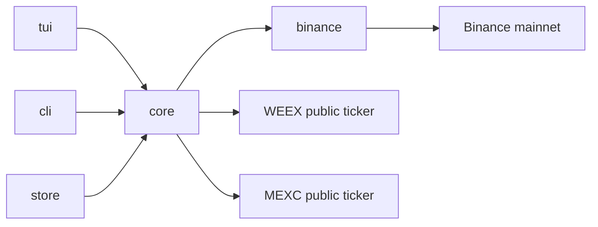

# Architecture

The dependency direction is enforced by package boundaries:

`cmd/orbix` composes the CLI and TUI. Both front ends call application services under `internal/core`; those services depend on the typed REST/WebSocket clients under `internal/binance`. `internal/binance/endpoints` is the transport-level GET allowlist. Account REST calls must pass its signed-route checks; no account mutation route is registered.

The TUI owns Bubble Tea state and renders from asynchronous command results. Spot heatmap ticker requests use the selected exchange's public Binance, WEEX, or MEXC endpoint; WEEX and MEXC percent ratios are normalized to percentage points. The market stream manager reconnects and fans out into bounded queues. The local order book does not mark itself valid until it has installed a REST snapshot and bridged the buffered diff sequence. SQLite is an optional local cache; live market requests remain available when the DB cannot be opened.

The CLI writes data to stdout and diagnostics to stderr. Secret adapters prefer the OS keychain and fall back to environment variables. Redacted JSON logs never go to the TUI output stream. There is no phone-home telemetry.
